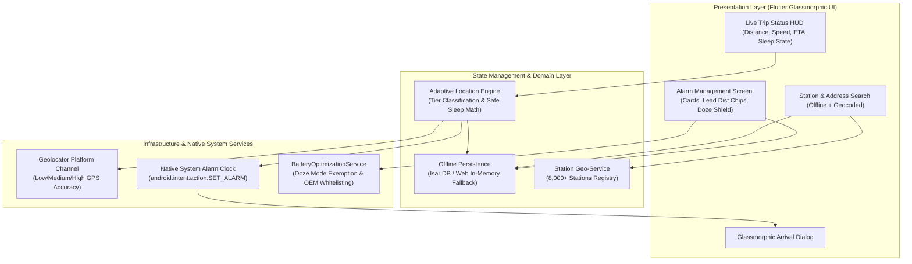
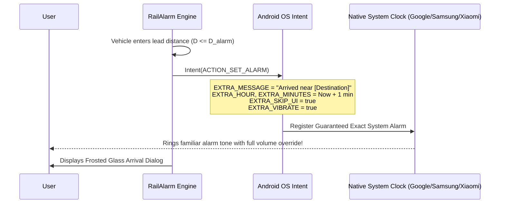

# Design.md - RailAlarm System Architecture & Design Specification

---

## 1. Executive Summary

**RailAlarm** is a smart, offline-first, battery-efficient location-triggered wake-up companion app built with Flutter. Crafted primarily for train commuters and long-distance rail passengers—as well as intercity bus and road travelers—RailAlarm guarantees travelers never miss their destination station while protecting their peaceful sleep from unpredictable transit delays and aggressive OS battery management.

RailAlarm delivers this reliability through **adaptive distance-tiered GPS tracking**, **dynamic "Safe Sleep" math**, **offline geocoding for 8,000+ railway stations plus custom road addresses**, and **fail-safe delegation to the native Android system alarm clock**.

---

## 2. Problem Statement & Design Objectives

### 2.1 The Problem & Personal Motivation
1. **The Train Delay Sleep-Loss Paradox**: Time-based phone alarms require guessing arrival time hours in advance. When trains are delayed overnight by 2, 4, or 6 hours, travelers are violently awakened at 4:00 AM only to discover their train is still 150 km away, losing precious sleep and arriving exhausted.
2. **Aggressive Battery Drain**: Keeping standard GPS listeners active for a 6 to 12-hour train trip depletes mobile battery prematurely (often 10-15% per hour).
3. **Connectivity Dead Zones**: Train tracks frequently traverse remote forests, mountain tunnels, and rural valleys where cellular coverage drops to zero.
4. **Aggressive OEM Battery Killers**: Modern smartphone OEMs (Xiaomi MIUI/HyperOS, Samsung One UI, OnePlus OxygenOS, Vivo FuntouchOS) aggressively kill background services and drop media audio streams during deep sleep (Doze Mode).
5. **Silent / DND Suppression**: Default notifications and media-stream sounds are muted when travelers sleep with "Silent" or "Do Not Disturb" active.

### 2.2 Key Design Objectives
- **Zero Internet Requirement**: 100% functional offline using a pre-indexed database of over 8,000 Indian Railways stations, with coordinate-based and custom address fallback for bus/road travel.
- **Adaptive Geofencing & Safe Sleep**: Dynamically compute sleep intervals based on distance and maximum physical speed ($\Delta t_{\text{sleep}} = \frac{D - D_{\text{alarm}}}{V_{\text{max}}}$) to achieve < 5% battery consumption over an entire overnight journey.
- **Fail-Safe Native Alarm Clock Delegation**: Trigger wake-up by scheduling directly through the phone's native Clock app (`android.intent.action.SET_ALARM`), guaranteeing that the traveler wakes to their trusted alarm sound regardless of OEM app-killing.
- **Sleep-First Dark Glassmorphism UI**: High-contrast, frosted glass containers layered over an organic dark backdrop (`background.jpg`), optimized for low-cognition travelers in dark train berths.

---

## 3. High-Level System Architecture

---

## 4. Adaptive Location Tracking & Safe Sleep Engine

Continuous GPS polling drains battery at ~10-15% per hour. RailAlarm uses a mathematically proven **Adaptive Distance-Tiered Safe Sleep Algorithm** that modulates both hardware sensor accuracy and polling intervals according to physical constraints.

### 4.1 The Dynamic Safe Sleep Formula

At any distance $D$ from the destination with user-configured alarm lead distance $D_{\text{alarm}}$ (e.g. 2, 5, or 10 km) and maximum train velocity $V_{\text{max}}$ (130 km/h for Indian express trains):

$$\Delta t_{\text{sleep}} = \min\left(\max\left(\frac{D - D_{\text{alarm}}}{V_{\text{max}}}, \Delta t_{\text{min}}\right), \Delta t_{\text{max}}\right)$$

Where:
- $\Delta t_{\text{max}}$ and $\Delta t_{\text{min}}$ are bounded by the current **Distance Tier**.
- **Stationary Traffic Back-Off**: If the vehicle's speed drops below $3\text{ km/h}$ (e.g., waiting at an outer signal or station), the engine backs off to the maximum interval for that tier, saving battery while standing still.

### 4.2 Distance Tier Matrix

| Tier | Distance to Destination ($D$) | Sensor Accuracy | Sleep Interval Bounds | Battery Impact |
| :--- | :--- | :--- | :--- | :--- |
| **Zone 1: Far** | $D > 50\text{ km}$ | `LocationAccuracy.low` (Coarse/Cell) | $10 - 15\text{ mins}$ | $< 0.4\% / \text{hr}$ |
| **Zone 2: Approaching** | $15\text{ km} < D \le 50\text{ km}$ | `LocationAccuracy.medium` (Balanced) | $3 - 5\text{ mins}$ | $\sim 1.0\% / \text{hr}$ |
| **Zone 3: Near** | $D_{\text{alarm}} < D \le 15\text{ km}$ | `LocationAccuracy.high` (Fine GPS) | $30 - 60\text{ seconds}$ | $\sim 2.5\% / \text{hr}$ |
| **Zone 4: Alarm Range** | $D \le D_{\text{alarm}}$ | `LocationAccuracy.best` | $10\text{ seconds}$ (Trigger Alarm) | Immediate Dispatch |

### 4.3 Haversine Distance Calculation

Great-circle distance between current GPS $(\phi_1, \lambda_1)$ and target $(\phi_2, \lambda_2)$:

$$a = \sin^2\left(\frac{\Delta \phi}{2}\right) + \cos(\phi_1)\cos(\phi_2)\sin^2\left(\frac{\Delta \lambda}{2}\right)$$
$$c = 2 \cdot \text{atan2}\left(\sqrt{a}, \sqrt{1-a}\right)$$
$$D = R \cdot c \quad (\text{where } R = 6371.0\text{ km})$$

---

## 5. Native System Alarm Clock Delegation

Rather than implementing a fragile in-app audio playback service that is susceptible to OS background termination, RailAlarm delegates wake-up directly to the **native Android System Clock**:

### 5.1 Why Native System Alarm Delegation Wins
1. **100% Fail-Safe Wake-Up**: System clock alarms use Android's internal `AlarmManagerService` running as UID 1000 (system), which cannot be killed by aggressive OEM power managers.
2. **User Familiarity**: Travelers wake up to their accustomed alarm sound and vibration cadence rather than an unfamiliar app ringtone.
3. **No Audio Focus Collisions**: Avoids conflicts with podcasts, white noise, or offline music apps that passengers listen to while falling asleep.
4. **Instant Testability**: Built-in "Test Native Alarm" button allows travelers to verify their device's clock response anytime before going to sleep.

---

## 6. Offline Multi-Modal Destination Support

RailAlarm supports three distinct modes of destination input:
1. **8,000+ Preloaded Railway Stations**: Instant offline search across all Indian Railways stations by Station Code (e.g. `NDLS`, `SBC`, `MAS`, `PGT`, `TCR`) or Station Name with debounced caching.
2. **Custom Bus & Road Addresses**: Geocoding integration allows road and bus commuters to set alarms for highway intersections, town bus stands, and landmarks.
3. **Raw GPS Coordinates**: Direct coordinate entry (e.g., `12.9716, 77.5946`) for rural drop-offs, industrial depots, or private sidings.
4. **Multi-Modal Lead Distance Presets**:
   - **2 km**: Bus / Car / City Transit
   - **5 km**: Road / Suburban Train
   - **10 km**: Express / Superfast Train

---

## 7. Background Resilience & Battery Whitelisting

### 7.1 Android Permissions Architecture
- `ACCESS_FINE_LOCATION` & `ACCESS_COARSE_LOCATION`: For tiered GPS / cell tracking.
- `ACCESS_BACKGROUND_LOCATION`: Ensures location updates continue when screen is locked.
- `FOREGROUND_SERVICE` & `FOREGROUND_SERVICE_LOCATION`: Android 14 compliant foreground execution.
- `SCHEDULE_EXACT_ALARM` & `USE_EXACT_ALARM`: Guarantees exact timing in deep sleep.
- `WAKE_LOCK`: Keeps CPU active during evaluation transitions.
- `REQUEST_IGNORE_BATTERY_OPTIMIZATIONS`: Whitelists RailAlarm from Android Doze Mode.
- `com.android.alarm.permission.SET_ALARM`: Enables direct system clock scheduling.

### 7.2 OEM-Specific Battery Saver Guidance
`BatteryOptimizationService` incorporates guided instructions for major manufacturers:
- **Xiaomi / POCO / Redmi**: Manage Apps > RailAlarm > Battery Saver > "No restrictions" & Autostart ON.
- **Samsung One UI**: Apps > RailAlarm > Battery > "Unrestricted" / Device Care > Never Sleeping Apps.
- **OnePlus / OPPO / Realme**: Battery > App Battery Management > Allow Background Activity.
- **Vivo / iQOO**: Battery > High background power consumption > Switch ON.
- **Google Pixel / Stock**: Apps > RailAlarm > App battery usage > "Unrestricted".

---

## 8. Visual Identity & Sleep-First Ergonomics

- **Organic Dark Glassmorphism**:
  - Backdrop: Wavy dark organic graphic (`background.jpg`).
  - Containers: Frosted glass (`BackdropFilter` sigma 10, subtle borders `white.withValues(alpha: 0.15-0.25)`).
- **Typography Pairing**:
  - Branding & Titles: Ultra-light `GoogleFonts.urbanist` (weight 100, letter spacing 1.5).
  - Telemetry & Codes: `GoogleFonts.victorMono` for monospace telemetry, station codes, and countdown stats.
- **Interactive Controls**:
  - Pill capsules with circular active toggles (solid white fill for active; greyed-out for inactive).
  - High-contrast, large touch targets designed for low-cognition, half-awake passengers.

---

## 9. Comprehensive Test Suite

| Test Suite | File | Tests | Status |
| :--- | :--- | :--- | :--- |
| **Geo & Safe Sleep Tests** | `test/unit/adaptive_location_test.dart` | 11 | Passed ✅ |
| **Alarm Dispatch Tests** | `test/unit/alarm_dispatch_service_test.dart` | 2 | Passed ✅ |
| **Entity Mapping Tests** | `test/unit/alarm_entity_test.dart` | 2 | Passed ✅ |
| **Station Search Tests** | `test/unit/station_service_test.dart` | 6 | Passed ✅ |
| **Battery & HUD Tests** | `test/unit/battery_optimization_service_test.dart` | 5 | Passed ✅ |
| **Simulated Route Test** | `test/unit/simulated_route_test.dart` | 1 | Passed ✅ |
| **App Smoke Test** | `test/widget_test.dart` | 1 | Passed ✅ |
| **Total Test Suite** | **7 test files** | **28 tests** | **100% Passed ✅** |

---

## 10. Completed Project Roadmap

- [x] **Phase 1: Core Architecture, Multi-Modal Location Search & UI Alignment**
- [x] **Phase 2: Adaptive GPS Polling & Battery-Efficient Safe Sleep Engine**
- [x] **Phase 3: Native System Alarm Clock Delegation & Arrival Dispatch**
- [x] **Phase 4: Background Resilience, Battery Optimization Helper & Live Trip HUD**
- [x] **Phase 5: Release Readiness, Platform Polish & Simulated Route Verification**
