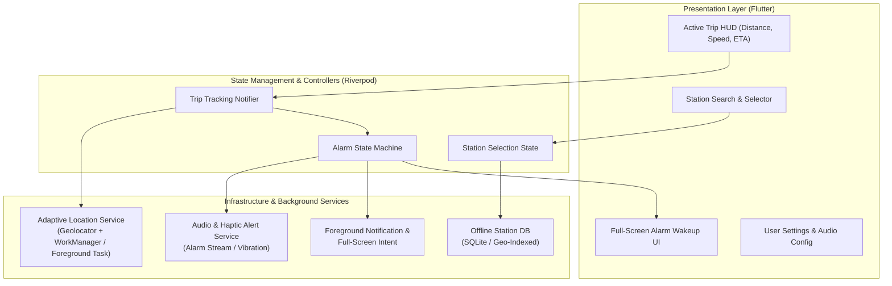
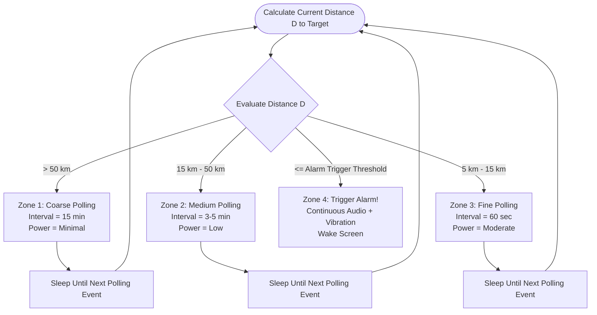

# Design.md - RailAlarm System Architecture & Design Specification

---

## 1. Executive Summary

**RailAlarm** is a smart, offline-first railway destination wake-up alarm application built with Flutter. Commuters and long-distance train passengers often face the risk of sleeping past their destination or interchange stations. Standard time-based alarms are ineffective due to unpredictable train delays or rescheduled routes. Furthermore, continuous GPS tracking severely drains phone batteries during multi-hour journeys, and trains frequently travel through cellular coverage dead zones.

RailAlarm solves these issues through **adaptive distance-tiered GPS tracking**, **offline station geocoding**, and **high-priority audio/vibration alarm overrides**.

---

## 2. Problem Statement & Design Objectives

### 2.1 The Problem
1. **Unpredictable Train Delays**: Time-based clock alarms ring at fixed times, regardless of whether the train is on time, early, or delayed by several hours.
2. **Aggressive Battery Drain**: Keeping standard GPS location listeners active for a 6 to 12-hour train trip depletes mobile battery prematurely.
3. **Connectivity Dead Zones**: Train routes often cross remote regions where network connectivity drops to zero.
4. **OS Background Restrictions**: Modern mobile operating systems (Android Doze, iOS Background App Refresh) kill or throttle background location tasks unless carefully architected.
5. **Silent / DND Suppression**: Default notifications can be suppressed if the traveler puts the phone on "Silent" or "Do Not Disturb" before sleeping.

### 2.2 Key Design Objectives
- **Zero Internet Requirement**: 100% functional offline after selecting the target station.
- **Adaptive Geofencing**: Dynamically adjust GPS query intervals based on current distance and speed to achieve < 5% battery consumption over an 8-hour journey.
- **Fail-Safe Alarm Dispatch**: Sound alarms using the hardware `STREAM_ALARM` audio channel, overriding silent/vibrate profiles and full-screen ringing UI on wake lock.
- **Sleep-Resistant UI**: Large, high-contrast, snooze/dismiss controls designed to be clearly visible and accessible to someone waking from deep sleep in a dark train berth.

---

## 3. High-Level System Architecture



---

## 4. Adaptive Location Tracking Engine

Continuous GPS polling drains battery at ~10-15% per hour. RailAlarm uses an **Adaptive Distance-Tiered Polling Algorithm** to minimize battery consumption while guaranteeing pinpoint accuracy near the destination.

### 4.1 Distance Tiering & Interval Matrix

| Distance to Target ($D$) | Expected Train Travel Time | Polling Frequency | Location Accuracy Mode | Expected Battery Impact |
| :--- | :--- | :--- | :--- | :--- |
| **Zone 1: Far** ($D > 50\text{ km}$) | $> 45\text{ mins}$ | Every $15\text{ mins}$ | Low / Cell Tower / Coarse | Minimal (< 0.5% / hr) |
| **Zone 2: Approaching** ($15\text{ km} < D \le 50\text{ km}$) | $15 - 45\text{ mins}$ | Every $3 - 5\text{ mins}$ | Balanced / Medium Accuracy | Low (~ 1% / hr) |
| **Zone 3: Near** ($5\text{ km} < D \le 15\text{ km}$) | $5 - 15\text{ mins}$ | Every $60\text{ seconds}$ | High Accuracy GPS | Moderate (~ 2% / hr) |
| **Zone 4: Alarm Range** ($D \le \text{Threshold}$, e.g. $5\text{ km}$) | Arrival Imminent | Real-time continuous ($5 - 10\text{ s}$) | Best / Highest Accuracy GPS | Short duration only |

### 4.2 Adaptive Polling Logic Flow



### 4.3 Distance Calculation
The distance between the current GPS coordinates $(\phi_1, \lambda_1)$ and the destination railway station coordinates $(\phi_2, \lambda_2)$ is computed using the **Haversine formula**:

$$a = \sin^2\left(\frac{\Delta \phi}{2}\right) + \cos(\phi_1)\cos(\phi_2)\sin^2\left(\frac{\Delta \lambda}{2}\right)$$
$$c = 2 \cdot \text{atan2}\left(\sqrt{a}, \sqrt{1-a}\right)$$
$$D = R \cdot c$$

Where $R = 6371\text{ km}$ (Earth's mean radius).

---

## 5. Alarm & Audio Subsystem

### 5.1 Volume & Hardware Override
- **Audio Stream**: Uses Android's `AudioManager.STREAM_ALARM`. This ensures that even when the phone is on Silent, Vibrate, or Media Volume 0%, the alarm rings at the designated RailAlarm volume.
- **Ramp-Up (Crescendo)**: Optional gentle wake-up setting that starts at 20% volume and scales to 100% over 30 seconds to avoid waking fellow coach passengers violently.
- **Vibration Pattern**: Intermittent heavy vibration pulse (`[0, 1000, 500, 1000, 500, 1000]`) to ensure the passenger wakes even if wearing earplugs.

### 5.2 Dismiss & Snooze Security
- **Full-Screen Wakeup**: When triggered, RailAlarm requests `FLAG_SHOW_WHEN_LOCKED` and `FLAG_TURN_SCREEN_ON` on Android via full-screen intent.
- **Accidental Dismissal Protection**: Sleepy passengers can accidentally tap "Dismiss" in their sleep. RailAlarm provides a **Slide-to-Dismiss** gesture or an optional math challenge/shake-to-dismiss feature.
- **Snooze Logic**: Snoozing re-evaluates distance; if the train is moving at high speed (> 60 km/h), snooze is capped at 3 minutes to prevent missing the platform.

---

## 6. Offline Data & Search Architecture

### 6.1 Station Database Schema
The pre-bundled SQLite database contains station metadata:

```sql
CREATE TABLE stations (
    id TEXT PRIMARY KEY,
    code TEXT NOT NULL UNIQUE,       -- Station code e.g., NDLS, MAS, SBC, CSMT
    name TEXT NOT NULL,              -- Full station name
    division TEXT,                   -- Railway division
    zone TEXT,                       -- Railway zone
    latitude REAL NOT NULL,          -- Decimal latitude
    longitude REAL NOT NULL,         -- Decimal longitude
    platforms_count INTEGER DEFAULT 1
);

CREATE INDEX idx_stations_code ON stations(code);
CREATE INDEX idx_stations_name ON stations(name);
CREATE INDEX idx_stations_geo ON stations(latitude, longitude);
```

### 6.2 Fast Offline Search
- Uses SQLite `FTS5` (Full-Text Search) or indexed prefix matching on both `code` (e.g. "NDLS") and `name` (e.g. "New Delhi") with debounced queries (< 100ms response time).
- Users can also drop a custom pin on an offline vector/tile map if traveling on non-indexed routes or private sidings.

---

## 7. Data Models

```dart
/// Represents a railway station in the local registry
class Station {
  final String id;
  final String code;
  final String name;
  final double latitude;
  final double longitude;

  const Station({
    required this.id,
    required this.code,
    required this.name,
    required this.latitude,
    required this.longitude,
  });
}

/// Active alarm configuration set by the user
class AlarmConfig {
  final String id;
  final Station destination;
  final double triggerDistanceKm; // e.g. 5.0 km
  final bool enableVibration;
  final bool crescendoVolume;
  final String ringtoneAsset;
  final DateTime createdAt;

  const AlarmConfig({
    required this.id,
    required this.destination,
    this.triggerDistanceKm = 5.0,
    this.enableVibration = true,
    this.crescendoVolume = false,
    required this.ringtoneAsset,
    required this.createdAt,
  });
}

/// Realtime trip telemetry
class TripTelemetry {
  final double remainingDistanceKm;
  final double? currentSpeedKmh;
  final Duration? estimatedTimeToArrival;
  final DateTime lastUpdated;
  final bool isGpsSignalLost;

  const TripTelemetry({
    required this.remainingDistanceKm,
    this.currentSpeedKmh,
    this.estimatedTimeToArrival,
    required this.lastUpdated,
    this.isGpsSignalLost = false,
  });
}
```

---

## 8. Platform Permissions & Lifecycle

### 8.1 Android Specifics
- **Permissions**:
  - `ACCESS_FINE_LOCATION` & `ACCESS_COARSE_LOCATION`: Required for GPS/Cell tower location.
  - `ACCESS_BACKGROUND_LOCATION`: Necessary for tracking while the screen is off.
  - `FOREGROUND_SERVICE` & `FOREGROUND_SERVICE_LOCATION`: Maintains the active trip foreground process with sticky notification.
  - `POST_NOTIFICATIONS`: Android 13+ permission for showing persistent status and alerts.
  - `USE_FULL_SCREEN_INTENT`: Direct wake-up screen upon alarm trigger.
  - `SCHEDULE_EXACT_ALARM`: Ensures periodic timers fire without Android Doze delay.
  - `WAKE_LOCK`: Prevents CPU sleep when alarm rings.
- **Battery Optimization Exemption**: Direct deep link to `ACTION_REQUEST_IGNORE_BATTERY_OPTIMIZATIONS`.

### 8.2 iOS Specifics
- **Capabilities & Keys**:
  - `NSLocationAlwaysAndWhenInUseUsageDescription`
  - `UIBackgroundModes` -> `location`, `audio`
  - Use of `significant-change location service` for Zone 1 and standard location service for Zone 3/4.

---

## 9. UI / UX Design & Screen Flow

1. **Dashboard / Destination Picker**:
   - Prominent search bar with instant autocomplete for station name or IR station code.
   - Recent & Favorite destinations.
   - Lead distance slider ($2\text{ km}$ to $20\text{ km}$, default $5\text{ km}$).
2. **Active Trip HUD**:
   - Dark theme by default (gentle on night eyes).
   - Large live telemetry: Distance Remaining (e.g., "14.2 km away"), Speed, and estimated arrival clock.
   - "Cancel Alarm" safety dialog.
   - Status indicator of GPS lock strength.
3. **Alarm Ringing Wakeup Screen**:
   - Full brightness override (temporary) with flashing contrast elements.
   - Large "Slide to Stop Alarm" to prevent accidental taps.
   - Quick 5-minute snooze button.

---

## 10. Development Roadmap & Phasing

- [x] **Phase 0**: Project setup & architectural blueprints (`Agents.md`, `Design.md`).
- [ ] **Phase 1**: Offline Station Database (SQLite) + Station Search UI.
- [ ] **Phase 2**: Geolocation Engine + Haversine calculation + Trip telemetry HUD.
- [ ] **Phase 3**: Background Foreground Service + Adaptive polling algorithm.
- [ ] **Phase 4**: Full-screen Alarm Trigger Screen + Audio/Vibration management.
- [ ] **Phase 5**: Battery stress-testing & Android/iOS permissions hardening.
