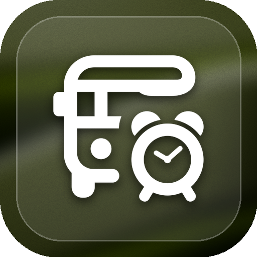
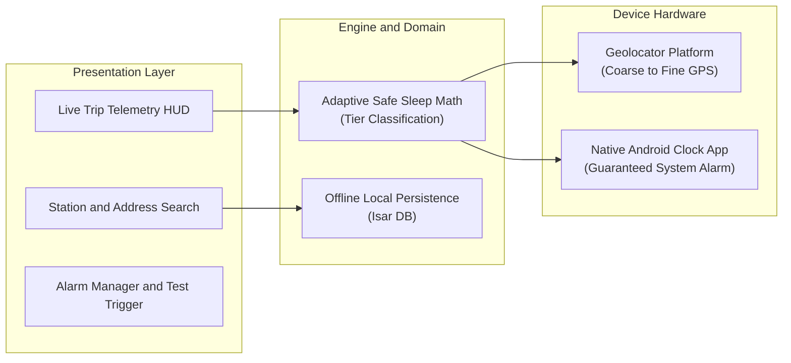

<div align="center">

  

  # RailAlarm
  
  **Sleep Soundly, Wake Timely. The Battery-Efficient Location Wake-Up Companion for Train, Bus and Road Passengers.**

  [](https://flutter.dev)
  [](https://dart.dev)
  [](https://github.com/Sreenandan2004/rail_alarm)
  [](LICENSE)
  [](https://github.com/Sreenandan2004/rail_alarm)

</div>

---

## The Origin Story

> "For years, on long train journeys back home, I watched my father set clock alarms at 3:30 AM or 4:00 AM, only to wake up exhausted, look out the berth window, and realize the train was delayed by 3 hours and still 120 km away.
>
> He had lost his deep sleep for nothing, and he could not fall back asleep."

Traditional clock alarms are blind to transit delays. **RailAlarm** was created to solve this once and for all: **an alarm that does not care what time it is, but wakes you exactly when your train, bus, or car enters your destination radius.**

---

## Key Features

- **Adaptive Safe Sleep Battery Engine**: Calculates physical velocity and remaining distance ($\Delta t_{\text{sleep}} = \frac{D - D_{\text{alarm}}}{V_{\text{max}}}$) to dynamically modulate GPS polling from 15 minutes down to 30 seconds. Consumes **less than 5% battery** on an 8-hour journey.
- **100% Offline-First**: Instant search across **8,000+ Indian Railways stations** with zero network requirement. Functions seamlessly through mountain tunnels and cellular dead zones.
- **Multi-Modal Transit Support**: Works beyond rail—set alarms for intercity bus terminals, highway drop-offs, and custom street addresses via offline geocoding and raw coordinates.
- **Fail-Safe Native Clock Delegation**: Dispatches directly to your phone native Android Clock app (`android.intent.action.SET_ALARM`). Wakes you with your trusted ringtone and bypasses aggressive OEM battery killers (Xiaomi, Samsung, OnePlus).
- **Doze Mode Shield**: Integrated manufacturer guidance to whitelist RailAlarm from OS background termination.
- **Live Trip Telemetry HUD**: Frosted-glass dashboard displaying real-time speed, estimated arrival (ETA), distance remaining, and next GPS check countdown.
- **Sleep-First Dark Glassmorphism UI**: High-contrast, frosted-glass design paired with organic dark backdrops, engineered for half-awake passengers in dark train berths.

---

## System Architecture



### Distance-Tier Polling Matrix

| Tier | Distance to Destination ($D$) | Sensor Accuracy | Polling Frequency | Battery Impact |
| :--- | :--- | :--- | :--- | :--- |
| **Zone 1: Far** | $D > 50\text{ km}$ | Coarse / Cell Network | Every $10 - 15\text{ mins}$ | $< 0.4\% / \text{hr}$ |
| **Zone 2: Approaching** | $15\text{ km} < D \le 50\text{ km}$ | Balanced / Medium | Every $3 - 5\text{ mins}$ | $\sim 1.0\% / \text{hr}$ |
| **Zone 3: Near** | $D_{\text{lead}} < D \le 15\text{ km}$ | High-Precision GPS | Every $30 - 60\text{ secs}$ | $\sim 2.5\% / \text{hr}$ |
| **Zone 4: Alarm Range** | $D \le D_{\text{lead}}$ | Best GPS | Real-Time Trigger | Native Clock Wake-Up |

---

## Getting Started

### Prerequisites
- [Flutter SDK](https://flutter.dev/docs/get-started/install) (`^3.8.1` or higher)
- Android Studio / VS Code with Flutter extension
- Android Device (API 26+) or Emulator

### Installation and Run

```bash
# 1. Clone the repository
git clone https://github.com/Sreenandan2004/rail_alarm.git

# 2. Navigate to project root
cd rail_alarm

# 3. Install packages
flutter pub get

# 4. Run automated test suite (29 tests)
flutter test

# 5. Launch debug build
flutter run
```

### Build Android APK

```bash
flutter build apk --debug
```

---

## Project Structure

```
rail_alarm/
├── android/                   # Native Android manifest, exact alarm and foreground services
├── assets/
│   ├── data/stations.json     # 8,000+ Indian Railways station registry
│   └── images/                # App branding and organic dark backdrops
├── lib/
│   ├── models/                # AlarmInfo, Station, and TrackingState models
│   ├── screens/               # HomePage and AlarmPage
│   ├── services/              # AdaptiveLocationService, AlarmDispatchService, IsarService
│   ├── utils/                 # Haversine distance and ETA calculations
│   └── widgets/               # TripStatusHud and reusable UI components
├── test/unit/                 # 7 unit and integration test suites
└── documentation/             # LinkedIn and Medium articles, architecture snapshots
```

---

## Testing

RailAlarm maintains comprehensive test coverage for all safety-critical paths:

```bash
flutter test
```

- `adaptive_location_test.dart`: Haversine math, stationary traffic back-off, safe-sleep bounds.
- `simulated_route_test.dart`: End-to-end 105 km journey simulation across all 4 distance tiers.
- `alarm_dispatch_service_test.dart`: Native intent parameters and clock scheduling bounds.
- `battery_optimization_service_test.dart`: OEM guidance verification.

---

## Author

Developed by **Sreenandan S**  
- **GitHub**: [@Sreenandan2004](https://github.com/Sreenandan2004)  
- **LinkedIn**: [Sreenandan S](https://www.linkedin.com/in/sreenandan-s-21sept2004/?isSelfProfile=true)  

---

## License

This project is licensed under the MIT License - see the [LICENSE](LICENSE) file for details.
